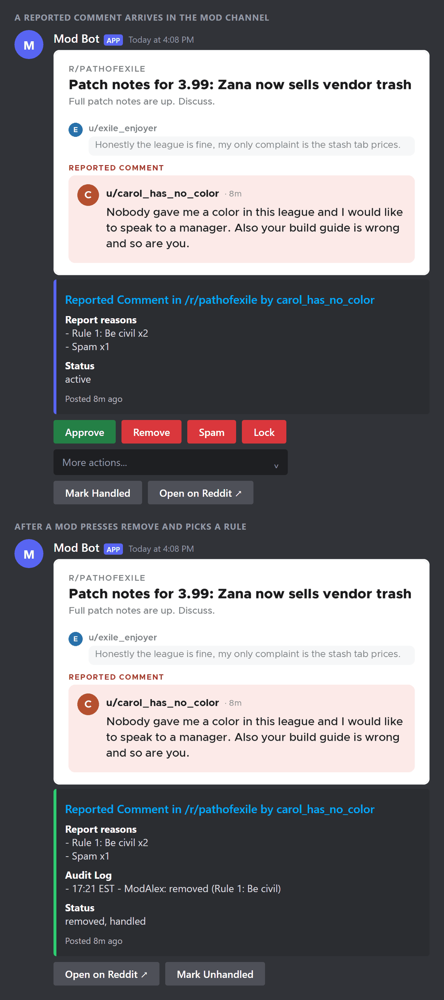

# Reddit Mod from Discord

A Discord bot that lets a mod team moderate a subreddit without leaving Discord. Each reported post or comment shows up in the mod channel as one message, with the content, the report reasons, and buttons. Pressing a button takes the action on Reddit and updates the message to show who did it.



The card at the top of each message is the bot's own output. The rest is redrawn to look like Discord.

From the message, a mod can:

- Approve, remove, mark as spam, or lock the item.
- Remove it with a Toolbox removal reason or a subreddit rule as the reason, and send the removal message.
- Ban the user, with a duration and a message.
- Send modmail to the user, or reply to the item as the mod account.
- Mark the item handled, so the rest of the team can see it's covered.

The message also shows the item's status and any mod log entries for it. Buttons keep working after a restart.

## Setup

You need Python 3, a Discord bot token, and a Reddit app.

1. Copy `.env.example` to `.env`.
2. Fill in `DISCORD_TOKEN`, `DISCORD_MOD_CHANNEL_ID`, `DISCORD_ALLOWED_ROLE_IDS`, `REDDIT_CLIENT_ID`, `REDDIT_CLIENT_SECRET` and `REDDIT_REFRESH_TOKEN`. Only members with an allowed role can press the buttons. Role ids belong to one Discord server, so update them if you move the bot.
3. Run `make run-bot`.

To run it in Docker, use `make docker`, which builds the image and starts the container. `make build-docker` and `make run-docker` do the two steps separately, and `make stop-docker` stops the container. The container keeps its data in `./data` on the host.

Two slash commands are available: `/modsync` polls Reddit right away, and `/modhealth` shows the bot's status.

## Settings

All of these are optional and go in `.env`.

- `REDDIT_SUBREDDIT`: the subreddit to watch.
- `POLL_INTERVAL_MINUTES`: how often to check for reports. Default 5.
- `POST_REPORT_THRESHOLD` and `COMMENT_REPORT_THRESHOLD`: how many reports an item needs before it's posted. Default 1.
- `MAX_REPORTS_PER_POLL`: Default 100.
- `MAX_ITEM_AGE_HOURS`: ignore items older than this. Default 72.
- `MODLOG_FETCH_LIMIT` and `MODLOG_MAX_AGE_DAYS`: how much mod log history to keep for the message. Defaults 100 and 30.
- `DISCORD_SILENT_NOTIFICATIONS`: post without notifying the channel.
- `DB_PATH` and `VIEW_STORE_TTL_HOURS`: where the SQLite database lives and how long message state is kept. Defaults `data/reddit_mod_from_discord.sqlite3` and 168.

## Getting a Reddit refresh token

Actions happen as the Reddit account that authorizes the token, so authorize it while logged in as the account you want the actions to come from. That account needs the `wikiread` scope to load Toolbox removal reasons, and `submit` to post replies.

Reddit may ask you to register for API access before it lets you create an app. See https://www.reddit.com/r/reddit.com/wiki/api/.

1. Create a Reddit app of the web app type, with the redirect URI `http://localhost:8080`.
2. Put its client id and secret in `.env`. If you used a different redirect URI, set `REDDIT_REDIRECT_URI` too.
3. On the machine you're sitting at, not inside the container, run:

```
make ensure-venv install
set -a && . ./.env && set +a
PYTHONPATH=src .venv/bin/python tools/obtain_refresh_token.py
```

4. Copy the printed `REDDIT_REFRESH_TOKEN` into `.env`.

You can use `REDDIT_USERNAME` and `REDDIT_PASSWORD` instead, but a refresh token is better for a long-running service, and it wins if both are set.

## Several subreddits or servers

One bot can serve several subreddits, in one Discord server or several. Copy `multi_server_config.json.example` to `multi_server_config.json` and set `MULTI_SERVER_CONFIG_PATH=multi_server_config.json` in `.env`. `make run-docker` mounts the file automatically.

Each top-level key is a setup name, and its values override the `.env` defaults for that setup. Give every setup a `discord_guild_id`, unless the setup name is the guild id itself. Two setups can share a guild to cover two subreddits in one server. Only the Discord token, `DB_PATH`, `VIEW_STORE_TTL_HOURS`, the demo options and `DEBUG_LOGS` can't be overridden. If a setup is missing a required value after merging, the bot won't start and logs which setups are incomplete.

```json
{
  "main": {
    "discord_guild_id": 123456789012345678,
    "discord_mod_channel_id": 111111111111111111,
    "discord_allowed_role_ids": [222222222222222222],
    "reddit_client_id": "app_client_id",
    "reddit_client_secret": "app_client_secret",
    "reddit_refresh_token": "refresh_token_here",
    "reddit_user_agent": "reddit-mod-from-discord/0.1 by u/mod_account",
    "reddit_subreddit": "example_subreddit",
    "poll_interval_minutes": 5,
    "post_report_threshold": 2,
    "comment_report_threshold": 2
  }
}
```

## Testing

If you delete Discord messages while testing and want the bot to treat those items as new again, clear that setup's history with `CLEAR_SETUP_ID=main make clear-history`. The id has to match a key in `multi_server_config.json`.
